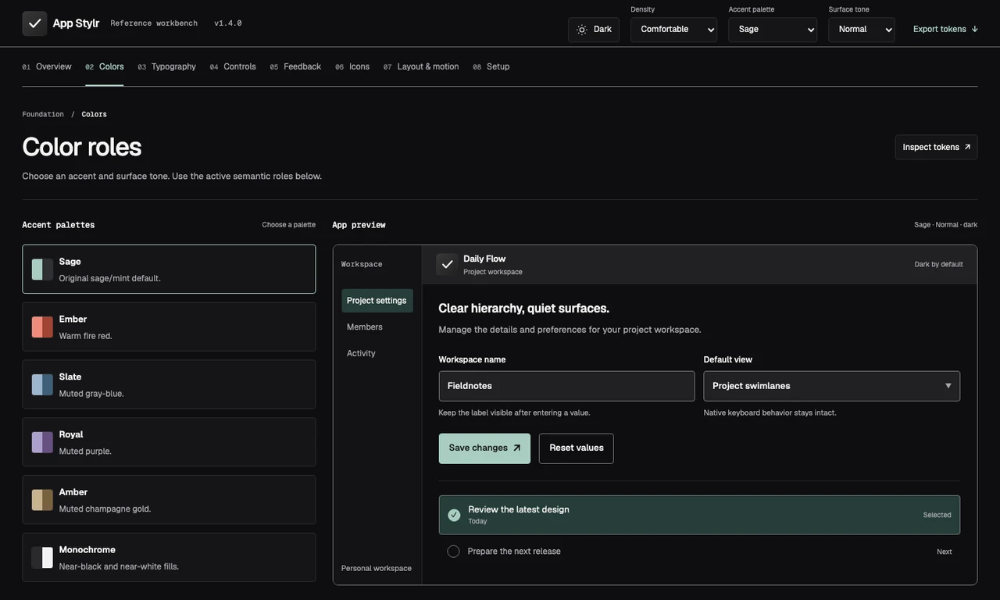

# App Stylr

Consistent color, typography, and icons across your products.

App Stylr brings together semantic design tokens, CSS and Swift adapters, bundled Geist fonts, and icon-generation tools for web, browser-extension, and macOS apps. Start with the shared foundation and build the interface your product needs.

[Explore the Visual Reference](https://kylbutlr.com/app-stylr) · [Read the documentation](#documentation) · [Report an issue](https://github.com/kylbutlr/app-stylr/issues)

## Preview



Visual Reference with illustrative interface specimens. [App overview](https://kylbutlr.com/apps/app-stylr).

## Release channels

The installation examples use the **v1.4.1 GitHub tag** for the CSS, assets, command-line tools, and Swift package. They do not require publication to the npm registry. See the [release process](./docs/releases.md) for channel verification and publication.

## Quick start

Requires Node.js 20 or newer for the command-line tools.

```sh
npm install "github:kylbutlr/app-stylr#v1.4.1"
```

Import the fonts and tokens once in your application stylesheet:

```css
@import "app-stylr/fonts.css";
@import "app-stylr/css";

.panel {
  color: var(--ui-text);
  background: var(--ui-surface);
  border: 1px solid var(--ui-border);
  border-radius: var(--radius-card);
  padding: var(--space-24);
}
```

App Stylr apps are **dark mode first**: dark mode is the default, with an optional light mode toggle. Start the app with:

```html
<html lang="en" data-app-stylr-theme="dark">
```

If your app offers a light mode toggle, switch `data-app-stylr-theme` to `light` when selected. Both themes use the same semantic roles. The toggle belongs to the consuming app. Run the [complete web example](./examples/web/README.md) for a framework-free starting point.

### Browser extensions

Bundle the CSS and fonts with your extension. Use a Shadow DOM root for injected interfaces. The [extension guide](./docs/browser-extensions.md) covers setup and isolation.

### Swift and SwiftUI

Add `https://github.com/kylbutlr/app-stylr` in Swift Package Manager using the exact version `1.4.1`, then add the `AppStylr` product to your target.

```swift
import AppStylr
import SwiftUI

struct SettingsPanel: View {
  private let theme = AppStylrTokens.dark

  var body: some View {
    Text("Settings")
      .foregroundStyle(theme.text)
      .padding(AppStylrTokens.Spacing.space16)
      .background(theme.surface)
  }
}
```

Swift tools 5.9 is required. Supported platform floors are macOS 10.15, iOS 13, tvOS 13, and watchOS 6. Native controls and interactions stay with the platform.

## What is included

| Resource | Use it for |
| --- | --- |
| Semantic tokens | Shared colors, type, spacing, radii, sizing, and motion values |
| CSS and Swift adapters | Generated values for web and native interfaces |
| Geist Sans and Geist Mono | Bundled, licensed typography |
| Icon assets and generator | Favicons, extension icons, Apple touch icons, and PWA icons |
| Visual Reference | Light and dark specimens, typography, feedback, and icon construction |
| Adoption guides and templates | Setup, compatibility, and deliberate upgrades |

Layouts, navigation, and application components stay in your product. Read the [design guidance](./docs/design-practice.md) for adapting the foundation.

## Accent palettes

Sage keeps the original sage/mint default. Ember, Slate, Royal, Amber, and Monochrome offer alternate accents. Choose an accent, then independently choose Lighter, Normal, or Darker surfaces. Normal preserves the original theme values; status meanings and icons stay consistent. Set both selections beside the theme attribute, such as `data-app-stylr-accent="royal" data-app-stylr-tone="lighter"`. See [accent palettes and surface tones](./docs/accent-palettes.md).

## Native form controls

For optional native input and select styling, import `app-stylr/controls.css` after the tokens and add `data-app-stylr-controls` to your app root. The recipe supplies control padding, chevron clearance, focus and validation states, and a progressively enhanced option picker. Layout and application behavior remain yours. See [dropdowns and inputs](docs/form-controls.md) for keyboard behavior, density, light mode, and platform fallback limits.

## Generate icons

Use a restrained monochrome graphite tile and a light identifying glyph. Design at 16px first, then inspect larger exports. A dedicated `--source-16` drawing is optional; the icon stays the same across accent palettes.

Generate the supported web and extension sizes:

```sh
npx app-stylr-icons --source assets/app-icon.svg --output public/icons
```

The [platform icon guide](./docs/platform-icons.md) includes export sizes, favicon setup, and manifest snippets.

## Package interface

| Import | Contents |
| --- | --- |
| `app-stylr/css` | Light and dark CSS custom properties |
| `app-stylr/fonts.css` | Bundled Geist font faces |
| `app-stylr/tokens` | Canonical JSON tokens |
| `app-stylr/assets/*` | Fonts and reusable icon assets |
| `app-stylr/templates/*` | Optional setup templates |
| `app-stylr/chrome-theme/*` | Generated Chrome theme |
| `app-stylr/package.json` | Package metadata |

The package also provides `app-stylr-reference` for portable reference builds, `app-stylr-chrome-theme` for Chrome theme exports, and `app-stylr-macos-release-check` for local release metadata checks. Run a command with `--help`, or read the [CLI reference](./docs/cli.md) and [package interface](./docs/package-interface.md).

## Documentation

- [Design practice](./docs/design-practice.md) and [conventions](./docs/conventions.md)
- [Compatibility and upgrades](./docs/compatibility.md)
- [v1.4.1 migration](./docs/migrations/v1.4.1.md), [v1.4.0 migration](./docs/migrations/v1.4.0.md), and [changelog](./CHANGELOG.md)
- [Browser extensions](./docs/browser-extensions.md) and [platform icons](./docs/platform-icons.md)
- [Public README guidelines](./docs/public-readmes.md) and [template](./templates/public-product-readme.md)
- [Game Interface profile](./docs/games.md), [Balanced motion](./docs/balanced-motion.md), and [macOS release checks](./docs/macos-sparkle.md)
- [Hosting the Reference](./docs/deployment.md) and [release process](./docs/releases.md)

## Development

```sh
npm ci
npm test
npm run package:check
swift build
```

Shared values live in `tokens/app-stylr.json`. Edit that source and run `npm run build` to regenerate the CSS and Swift adapters. Icon and Chrome-theme changes use `npm run icons` and `npm run chrome-theme`. See the [generated-file policy](./docs/generated-files.md).

To inspect the generated Reference:

```sh
npm run site
npm run reference
```

Open [localhost:4187](http://localhost:4187/). Stop the server with Ctrl+C in the same terminal.

## Privacy and support

App Stylr processes selected files locally. It has no account, upload feature, or telemetry. See the [privacy details](./docs/privacy.md).

Use [GitHub Issues](https://github.com/kylbutlr/app-stylr/issues) for reproducible problems and focused proposals. Read the [support guide](./SUPPORT.md), [security policy](./SECURITY.md), and [contribution guide](./CONTRIBUTING.md) for reporting and development details. Keep credentials and confidential application data out of public reports.

## License

Created and maintained by [Kyle Butler](https://kylbutlr.com). Available under the [MIT License](./LICENSE).
